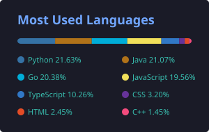

   
  

🌐 <b><a href="https://zhukovskyi.space/">zhukovskyi.space</a></b>: blog, open-source tools and Dre Dev apps

### 🛠️ Things I'm building

<table>
<tr>
<td width="50%" valign="top">

#### 🛡️ [k8s-guardian](https://github.com/andronaft/k8s-guardian)
*"The YAML is valid, but will it actually run in prod?"*

Checks and safely fixes manifests, Helm charts and Kustomize, looks at the live cluster, catches breaking changes, and exports the same rules to the cluster as admission policies.

`Go` `kubectl plugin` `GitHub Action` `MCP`

</td>
<td width="50%" valign="top">

#### 🩺 [health-os](https://github.com/andronaft/health-os)
*My health records, in my own Postgres, talking to any AI assistant.*

Labs, meds, wearables and food log behind guarded MCP tools. Safety rules are code, not vibes, and the AI can't save anything until I approve it.

`Python` `PostgreSQL` `pgvector` `MCP`

</td>
</tr>
<tr>
<td width="50%" valign="top">

#### 🔦 [Logbeam](https://github.com/andronaft/Logbeam)
*Make logs readable again.*

A browser extension: colored levels, stack traces that stick together, field filters, p95 in one click, diff between two CI runs, leaked-secret warnings. Nothing leaves your browser.

`TypeScript` `Chrome` `Firefox`

</td>
<td width="50%" valign="top">

#### 🗜️ [FileForge](https://github.com/andronaft/FileForge)
*Your files never leave your device.*

A browser extension and web app with 51 tools: crop, resize, adjust, collage, compress, HEIC → JPG, SVG → PNG, strip EXIF, merge, split, booklet and fill PDF forms, PDF → text, Markdown → PDF, rename files, diff, hashes, QR codes, and a pipeline that chains them. Ukrainian and English UI. No server, no accounts, works offline.

`JavaScript` `Chrome` `Firefox` `PWA`

</td>
</tr>
<tr>
<td colspan="2" valign="top">

#### ☕ [jvm-fit](https://github.com/andronaft/jvm-fit)
*"Will this JVM actually fit in its container?"*

Reads your pod spec and JVM flags together and tells you before deploy: heap plus non-heap against the memory limit, CPU limits and GC choice, probes. Rules verified on real JDKs.

`Go` `Kubernetes` `JVM`

</td>
</tr>
</table>

### 📦 Latest releases

<!-- LATEST:START -->
- 🚀 **[FileForge v1.3.0](https://github.com/andronaft/FileForge/releases/tag/v1.3.0)** · 2026-11-14
- 🚀 **[jvm-fit v0.1.1](https://github.com/andronaft/jvm-fit/releases/tag/v0.1.1)** · 2026-11-11
- 🚀 **[Logbeam v0.9.0](https://github.com/andronaft/Logbeam/releases/tag/v0.9.0)** · 2026-10-21
- 🚀 **[health-os v0.3.0](https://github.com/andronaft/health-os/releases/tag/v0.3.0)** · 2026-10-18
- 🚀 **[k8s-guardian v0.7.0](https://github.com/andronaft/k8s-guardian/releases/tag/v0.7.0)** · 2026-10-12
<!-- LATEST:END -->

### 🧪 What I'm into

- 🤖 AI agents that are allowed to touch real data, safely
- ☸️ Kubernetes, and making it boring in production
- 📈 Observability: if it's not on a dashboard, it didn't happen
- ☕ Java since forever, Go lately, Python and TypeScript when they fit. A language is just a tool; the problem decides which one

### 🧰 Toolbox

  

### 📱 Building right now: mobile apps, and I need testers

On the side I'm building about two dozen small Flutter apps for Android and iOS, published as **Dre Dev**. Each one does one job well: focus and fasting timers, calculators and PDF quotes for trades (electricians, painters, roofers, HVAC, pools, concrete), and logs for hobbies (sourdough, soap, knitting, beekeeping, aquariums, coffee). No accounts, no ads, and the data stays on your phone.

**Google Play needs testers before a new developer can publish:** at least 12 people who keep the app installed for 14 days. If you have an Android phone, it takes two minutes:

1. Join the [testers group](https://groups.google.com/g/test-dre-application). One group covers all my apps, and you can mute it.
2. Open the [testers page](https://zhukovskyi.space/testers/) on your phone, tap "Become a tester" and install the app from Google Play.
3. Keep it installed for 14 days. Opening it now and then helps a lot.

**Have an iPhone?** The first apps are on their way to the App Store, and Apple sends TestFlight invites by email. Fill in the [sign-up form](https://forms.gle/Vn9wgynXFbegDsWS7), choose iPhone, and I'll send you the link.

  
  
  

